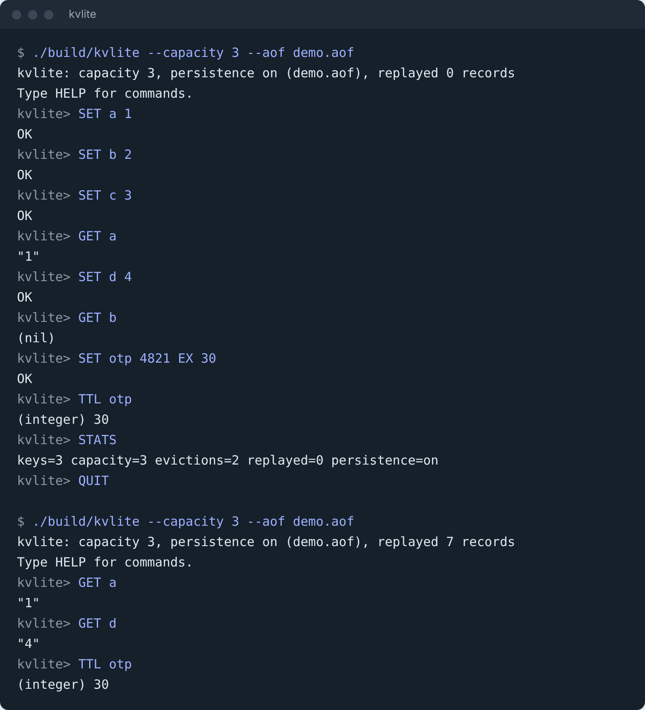

# kvlite

[](https://github.com/nickittime/kvlite/actions/workflows/ci.yml)


A small in-memory key-value store in C++17, with LRU eviction, per-key expiry and an append-only file that survives crashes.

- **O(1) LRU cache:** a hash map plus a doubly linked list, written from scratch
- **Expiring keys:** `SET key value EX 30`, `TTL`, `EXPIRE`, with Redis-style replies
- **Persistence:** every write goes to an append-only file, which is replayed on startup. A half-written last record is detected and cut off.
- **Tested:** 34 GoogleTest tests, including a 20,000-step randomized test against a reference model. CI builds on GCC, Clang, GCC with AddressSanitizer and UBSan, and MSVC.

---

## Why I built it

<!-- Edit into your own words. -->
I've practised data structures in C++ through problem sets. I wanted to use them in a complete program, with file I/O, crash recovery, tests and CI, and an LRU cache is the core of real caches like Redis and Memcached.

## Run it

Needs CMake 3.16+ and a C++17 compiler (GCC 9+, Clang 10+ or Visual Studio 2019+). The first configure downloads GoogleTest.

**Linux / macOS**

```bash
git clone https://github.com/nickittime/kvlite.git
cd kvlite
cmake -S . -B build -DCMAKE_BUILD_TYPE=Release
cmake --build build
ctest --test-dir build --output-on-failure    # 34 tests
./build/kvlite --capacity 3 --aof demo.aof
```

**Windows (Developer PowerShell for Visual Studio)**

```powershell
cmake -S . -B build
cmake --build build --config Release
ctest --test-dir build -C Release --output-on-failure
.\build\Release\kvlite.exe --capacity 3 --aof demo.aof
```

You can also pipe commands in: `printf 'SET a 1\nGET a\n' | ./build/kvlite`

## Demo

A store with room for 3 keys, persisting to `demo.aof`. `GET a` makes `a` recently used, so when `SET d` needs room it evicts `b`. After a restart, the data comes back from the file.



<details>
<summary>Same session as text</summary>

```text
$ ./build/kvlite --capacity 3 --aof demo.aof
kvlite: capacity 3, persistence on (demo.aof), replayed 0 records
Type HELP for commands.
kvlite> SET a 1
OK
kvlite> SET b 2
OK
kvlite> SET c 3
OK
kvlite> GET a
"1"
kvlite> SET d 4
OK
kvlite> GET b
(nil)
kvlite> SET otp 4821 EX 30
OK
kvlite> TTL otp
(integer) 30
kvlite> STATS
keys=3 capacity=3 evictions=2 replayed=0 persistence=on
kvlite> QUIT

$ ./build/kvlite --capacity 3 --aof demo.aof
kvlite: capacity 3, persistence on (demo.aof), replayed 7 records
Type HELP for commands.
kvlite> GET a
"1"
kvlite> GET d
"4"
kvlite> TTL otp
(integer) 30
```

</details>

## Commands

| Command | Reply |
|---|---|
| `SET key value [EX seconds \| PX ms]` | `OK` |
| `GET key` | `"value"` or `(nil)` |
| `DEL key` | `(integer) 1` if deleted, else `0` |
| `EXISTS key` | `(integer) 1` or `0` |
| `EXPIRE key seconds` | `(integer) 1` if the key exists, else `0` |
| `TTL key` | seconds left, `-1` = no expiry, `-2` = no such key |
| `SIZE` | number of live keys |
| `STATS` | keys, capacity, evictions, replayed records |
| `COMPACT` | rewrites the append-only file with only the current data |
| `HELP`, `QUIT` | |

Use double quotes for values with spaces. Inside quotes, `\"`, `\\` and `\n` are escapes.

---

## How it works

```
 tokenize(line) ──► execute(store, args) ──► Store
                                              ├── LruCache<string, Entry>   hash map + linked list
                                              │      Entry = { value, optional expiry time }
                                              └── Aof                       append-only file
```

<details>
<summary><b>LRU cache: O(1) get, put and evict</b></summary>

`include/kvlite/lru_cache.hpp`

- A `std::list` holds `(key, value)` pairs in recency order, most recent at the front.
- A `std::unordered_map` maps each key to its list node, so lookup is O(1) on average.
- On a hit, `list::splice` moves the node to the front. That relinks pointers without copying the value or invalidating iterators.
- When the cache is full and a new key arrives, the back node is evicted. An optional callback reports which key was evicted.

</details>

<details>
<summary><b>Expiry</b></summary>

- Each entry stores an absolute expiry time, not a countdown, so it stays correct across restarts.
- Expired keys are removed lazily, on the next read, and `SIZE` sweeps all of them. There is no background thread.
- The clock is injected (`Store::Options::clock`), so tests move time forward by hand and never sleep.

</details>

<details>
<summary><b>Append-only file and crash recovery</b></summary>

Every write is appended as a header line, the raw bytes, then a newline:

```
S 0 1 5          ← op, expiry (epoch ms, 0 = none), key length, value length
khello
```

- Length prefixes make keys and values binary-safe, so spaces and newlines are fine.
- **Crash recovery:** on startup, each record is read and checked. If the last record is incomplete (the process died mid-write) or a header is corrupt, replay stops there and the file is cut back to the last complete record, so new writes don't follow garbage.
- **Evictions are logged as deletes.** Reads change LRU order but aren't logged, so a replay couldn't work out which key was evicted on its own.
- **Expired-while-down:** a record whose expiry has already passed is dropped during replay.
- **Compaction:** `COMPACT` writes the live data to `file.tmp` and renames it over the old file. The rename is atomic, so a crash leaves either the old file or the new one. Records are written least recent first, so the LRU order is rebuilt.

</details>

<details>
<summary><b>Tests</b></summary>

| File | What it checks |
|---|---|
| `tests/lru_cache_test.cpp` | eviction order, `peek` vs `get`, updates, and 20,000 random operations compared step by step with a simple vector-based model |
| `tests/store_test.cpp` | TTL boundaries, Redis TTL codes, capacity eviction |
| `tests/aof_test.cpp` | restart replay, binary-safe values, cut-off and corrupt tails, compaction, LRU order after compaction |
| `tests/commands_test.cpp` | quoting and escapes, every command, error messages |

</details>

## Limitations and next steps

- Single-threaded, and reads commands from stdin. A TCP server with a thread pool is the obvious next step.
- Writes are flushed to the OS but not `fsync`ed. Data survives a process crash, but not a power cut.
- No per-record checksum. A CRC32 would catch corruption in the middle of the file, not just at the end.
- Capacity counts keys, not bytes.

## What I learned

<!-- ADD after you've walked through the code: 3 bullets in your own words. docs/WALKTHROUGH.md has questions to test yourself with. -->
